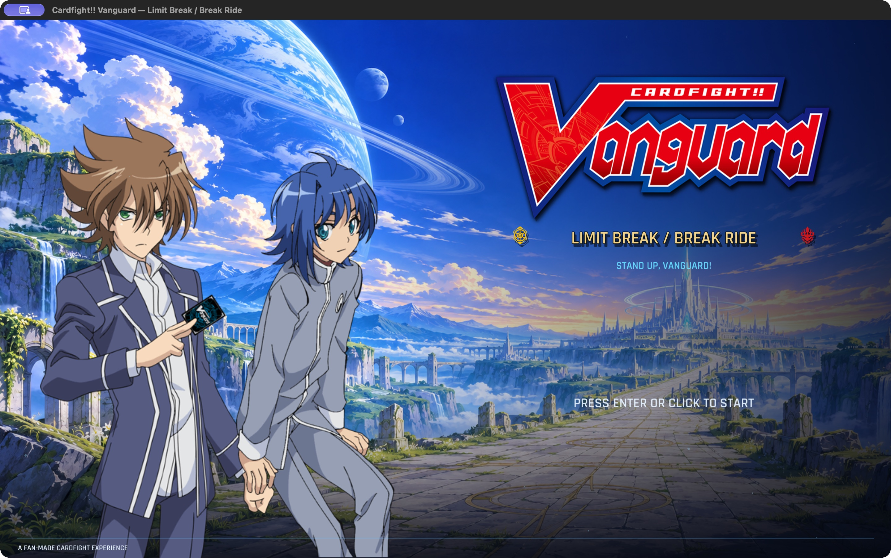

# Vanguard Rust Prototype



A small, visual desktop cardfight prototype set in the Limit Break and Break Ride era. The source is split by responsibility so the rules, cards, story, and rendering can be read independently.

## Run

From this project directory:

```sh
cargo run
```

The window opens at 1440 × 960 and can be resized. Startup shows loading progress, followed by an animated title scene with Aichi and Kai over a Planet Cray-inspired landscape. Press Enter or click to open Story Mode, Quick Fight, and Deck Builder. Entering a match loads decks and opening card art before revealing the field.

The app now has a transparent Vanguard icon and matching English title logo made only from sourced, non-AI artwork. On macOS, `python3 scripts/build_macos_app.py` builds `dist/Cardfight Vanguard.app` with a full-resolution Finder/Dock icon and bundled card art. The PNG/ICO/ICNS exports and provenance are under `assets/branding/`.

## Deck Builder

Build your Quick Fight deck in a full-window workshop with real card artwork and clan symbols. Browse **All Cards** or choose a color-coded nation and clan, then combine **Grade 0–4** filters. Search and sorting stay at the top; the card preview, deck strip, and grade/trigger counts stay visible. Choose a clan and **Load Clan Sample** to get started. Select cards to add/remove copies, then **Save Deck** or **Save & Fight**. Saved decks carry into later Quick Fights. See the [deck workshop guide](docs/deck-builder.md) for controls, validation, persistence, and visual references.

## Controls

- **Ride:** click a playable card in your hand. The game highlights legal cards.
- **Opening:** play rock-paper-scissors. The winner chooses first or second; the CPU chooses first when it wins. Select zero to five cards for one mulligan, then confirm both hands and Stand Up.
- **Phases:** Stand and Draw advance visibly before Ride. Draw happens once per turn, including the opening turn. The first global turn skips Battle and offers End Turn in Main.
- **Call:** select a legal card and then a rear circle. Calling over an occupied circle retires its unit. Trigger units can be called too.
- **Attack:** click one of your standing front-row units, then click the opposing Vanguard or an occupied front-row rear-guard.
- **Boost:** tap the eligible unit behind an attacker to select boosting; tap again while choosing a target to remove it. You can also choose Boost/No Boost after selecting a target. Live attack/defense bars reflect boosts, guards and triggers.
- **Guard:** for each opponent attack, choose **No Guard** or move one or more highlighted cards to the Guardian Circle. Drag a card from hand onto the circle, or click a hand card or eligible interceptor and then the circle. Choose **Done Guarding** to resolve the attack.
- **Damage Zone / Counter-Blast:** cards lie sideways in one overlapping vertical stack, like the printed mat. During your turn, click a card's exposed strip to turn it face down for manual Counter-Blast; click again to restore it for manual Counter-Charge or to correct a click. `CB` shows available face-up damage. Hover face-up damage for a larger preview. You cannot flip the opponent's damage or change resources during an unresolved attack or after the match ends.
- **End Turn:** passes play to the CPU. Finish guarding or pass on each attack to continue.
- **Limit Break / Break Ride:** activate the corresponding buttons when available. Limit Break automatically pays its own Counter-Blast 2 from available face-up damage; manual flips do not activate an ability or prepay that button's cost.
- **Trigger Zone:** a resolved checked card leaves this zone immediately: drive cards go to hand, damage cards go to damage. No previous-check afterimage remains.
- **Check animations:** Drive and damage reveals use English angled cut-ins, a sleeve-to-card flip, the checking fighter's real character render, and distinct Critical/Draw/Stand/Heal announcements. The battle waits for the animation before presenting trigger choices. See the [check presentation guide](docs/check-animations.md).
- **Triggers:** choose the highlighted unit for power, critical or Stand; select a damage strip for Heal. Checks pause for your choices and then continue.
- **Log:** opens a compact recent-plays drawer. **Escape** closes it or cancels a current selection before returning to the menu.

Story Mode follows a six chapter route through the Card Capital introduction, tournaments and Asia Circuit, VF Koshien, the Reversed fighters, and the Star-vader finale. The Link Joker chapter lets you choose the Hitsue, Fukuhara, or Miyaji school route. The fictionalized story beats and selected cards are based on the 3DS games *Ride to Victory!!* and *Lock on Victory!!*; research notes and sources are in [RESEARCH.md](RESEARCH.md).

## Developer documentation

See the [documentation index](docs/README.md), [architecture and screen flow](docs/architecture.md), and [complete function reference](docs/functions.md). The reference explains every named Rust function and asset-script function, including private helpers and tests.

The [VangPro research report](docs/research/vangpro-research.md) compares public gameplay materials and release-package observations with this codebase, then proposes a staged implementation roadmap.

## Project layout

- `src/main.rs` configures and runs the desktop window.
- `src/ui.rs` owns screen navigation and mouse input.
- `src/ui/board.rs` draws playmat zones, the sideways damage stack, counts, and turn status.
- `src/ui/presentation.rs` draws the shared title/menu/loading scene, official character renders and logo, animated particles, and loading progress.
- `src/ui/cards.rs` draws cards and hit areas; `src/ui/drawing.rs` holds shared vector primitives and palette.
- `src/game/card.rs` defines card, unit, and player data.
- `src/game/deck_editor.rs` owns catalog filters, sorting, editable lists, validation, samples, and saved Quick Fight decks.
- `src/ui/deck_workshop.rs` draws the full-window deck builder and handles its controls.
- `src/game/deck.rs` builds 50-card clan decks from the bundled official card catalog, with real card names, stats, triggers, and four-copy limits.
- `src/game/engine.rs` implements turn phases, attacks, guards, triggers, and CPU actions.
- `src/story.rs` contains chapter and school-route data.
- `assets/official_era_cards.json` contains the English official card entries used by the library and deck builder. `assets/card_images/` contains 2,083 optimized images sourced from Bushiroad's public card list. The match uses transparent circle artwork in `assets/tabletop/vanguard-zones.png`, Aichi/Kai sleeve PNGs, and the official character icons in `assets/fighters/`. Earlier original and supplied playmats remain in `assets/`.
- `scripts/fetch_era_card_assets.py` refreshes the card data and artwork. Install its optional dependency with `python3 -m pip install -r requirements-assets.txt`, then run `python3 scripts/fetch_era_card_assets.py`.
- `scripts/fetch_tabletop_assets.py` refreshes the playmat, sleeves, icons, and provenance manifest. Install `requirements-tabletop-assets.txt` first. Sleeve SVGs keep downloaded illustrations inside an editable rounded card frame; their PNGs have transparent exterior corners. CairoSVG needs the Cairo system library (on Homebrew macOS, set `DYLD_FALLBACK_LIBRARY_PATH=/opt/homebrew/lib` if needed).

The field follows the classic official guide: three aligned columns, five Rear-guard Circles, a central Vanguard, Guardian Circle toward the opponent, damage on the left, and Trigger/Deck/Drop down the right. The opposing half is mirrored. The damage pocket stacks up to six sideways cards; each has an exposed clickable strip, and hover previews show its full face upright. Hit testing follows the stack's drawing order. The green hex field, translucent metallic zones, corner portraits, floating phase list and compact commands draw on the official game references, especially Dear Days/2. The complete green Guardian Circle and yellow/blue unit circles retain the older field language. This prototype retains the Limit Break / Break Ride field rather than adding modern Ride Deck and Order zones.

## Prototype scope

This is a playable foundation, not a complete rules engine. CPU decisions, card effects, guard skills such as sentinels, and story events are simplified. The bundled pool covers English BT01–BT15, EB01–EB10, and TD01–TD13 records available from the official public API; some 3DS-exclusive, Japanese-only, and promotional cards are outside that source. The sample deck builder chooses legal-looking lists from that pool and is not an exact dump of the 3DS opponents' deck recipes. Card names and artwork belong to their respective owners; see [asset provenance](assets/card_images/README.md).

The [opening and battle architecture](docs/architecture.md) documents phase timing and trigger resolution. [Saved references](docs/images/references/README.md) include the RPS and redraw examples. [todo.md](todo.md) highlights the trigger, pause, Resolve and End Turn functions for the requested future automation.
