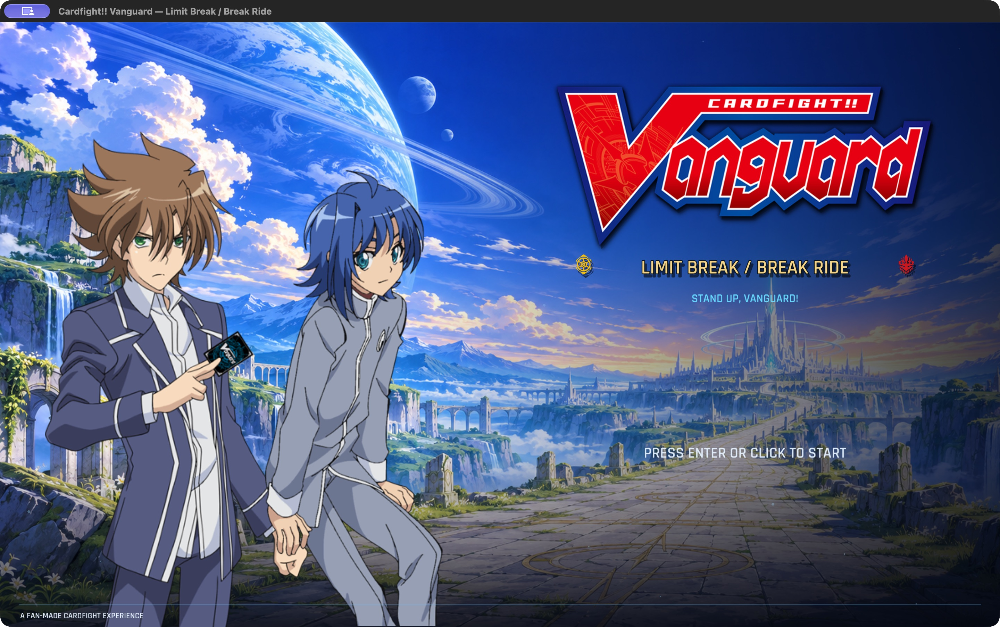
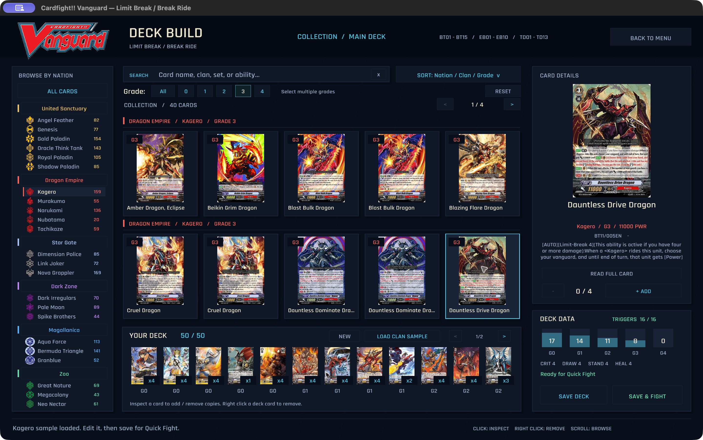
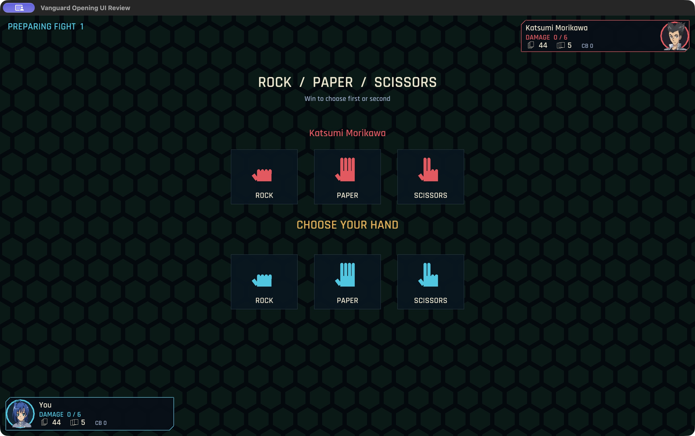
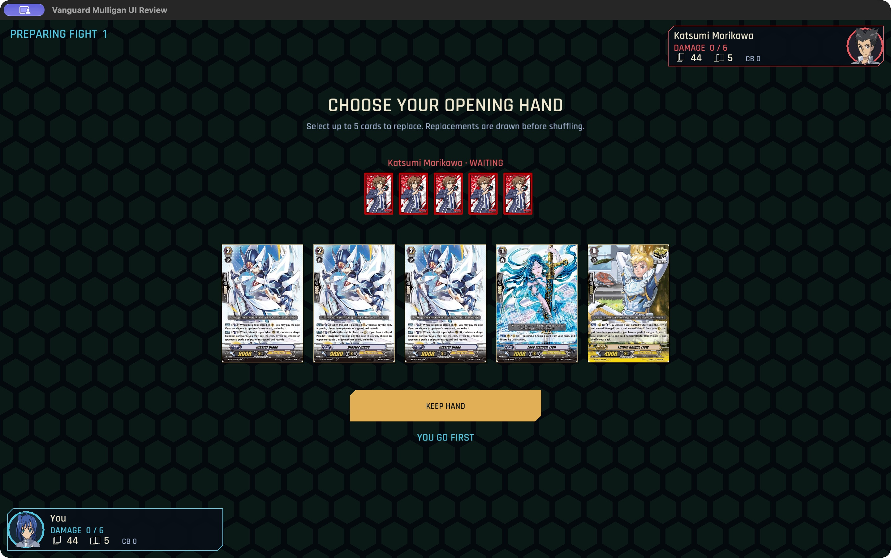

# Developer documentation

The [project README](../README.md) covers installation and controls. These documents explain how the implementation works.

- [Architecture](architecture.md): startup, screen navigation, asset ownership, battle flow, and the conventions that keep drawing and input aligned.
- [Check animations](check-animations.md): fighter-dependent English drive/damage cut-ins, reveal motion, trigger effects, and timing.
- [Deck workshop](deck-builder.md): nation/clan/grade browsing, sorting, real clan symbols, editing, saving, and custom Quick Fight decks.
- [Function reference](functions.md): every named Rust function and Python asset-tool function, including private helpers and tests, grouped by source file.
- [Research](../RESEARCH.md): era scope, rules references, and the publisher screenshots used for the field's presentation.
- [VangPro research](research/vangpro-research.md): public-source and release-package analysis, versioned feature evidence, and an implementation roadmap for this simulator.
- [Asset provenance](../assets/README.md): downloaded artwork, generated landscape, font license, refresh commands, and checksums.

- [Gameplay TODO](../todo.md): highlighted trigger/check/pause/end-turn functions and pending automatic battle completion.
- [Saved game references](images/references/README.md): preserved publisher screenshots, RPS/turn-order presentation, redraw example, trailer frames and user attachments.

## Current presentation

`images/title-screen.png` is an unedited capture of the running desktop application, taken after the Planet Cray opening and sideways damage-stack update. Refresh it after changing the title scene, and keep the image references in both repository and app READMEs pointing to this file.

## Maintaining these documents

When a function is added, renamed, removed, or changes responsibility, update its row in the function reference. Describe the actual prototype behavior, including manual controls and automatic costs, rather than assuming the implementation covers the full trading card game rules.

Run `cargo fmt --check`, `cargo test`, and `cargo build` from the application directory after changing Rust code. Visually check title/menu/loading screens and a match after presentation changes; geometry tests do not verify texture orientation, colors, or text readability.

### Deck workshop capture

This unchanged native capture shows clan symbols, top sorting/grade controls, real card previews, the deck strip, and live deck data.

### Opening review captures

These unchanged native captures use temporary review startup states to inspect each opening layout. The shipping application starts at Title and reaches these screens through normal fight loading. The review startup code is not included in the application.
