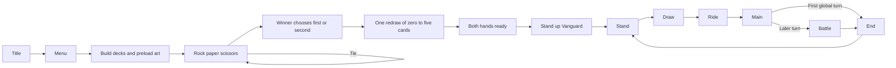

# Application architecture

## Startup and opening sequence

`src/main.rs` selects the custom non-AI app icon and configures the resizable Macroquad window and awaits `App::load`. Packaged macOS apps keep their multi-resolution bundle ICNS; direct Cargo launches use embedded 16/32/64 RGBA icon data. `scripts/build_macos_app.py` assembles the release app with its icon and external card image cache. The matching title mark is `assets/branding/game-logo.png`; both branding masters are reproducibly composited by `scripts/build_branding.py`. The loader renders real progress between artwork/database/tabletop initialization. `PresentationArt` owns the original landscape, official Aichi/Kai cutouts and logo, and bundled Rajdhani font; the font is shared throughout the app.

Story Mode selects a school route/chapter before loading; Quick Fight uses the first chapter and substitutes the saved custom player deck when available. The Library screen now hosts the full-window deck workshop; Result remains separate. `App::start_match` clears old selections, log visibility, power animation, and opening-card selections.

`MatchGame::new` prepares a starter Vanguard and five-card hand for each fighter, then waits in Setup. `engine/opening.rs` implements RPS, replayed ties, first/second selection, and a single mulligan. The CPU winner chooses first. Human selections are validated before any card moves. Selected cards go to the bottom (`Vec` index zero), replacements come from the top (`Vec::pop`), then the remaining deck is shuffled. The CPU keeps one card of grades one through three where possible. Both hands stay at five until the first actual Draw phase.

The requested first/second choice and bottom-return mulligan use current setup conventions alongside the historical card pool. They are explicit project behavior; the old 2014 rules used different setup details. No modern Ride Deck or Order zones are added.

## Deck workshop

`DeckWorkshop` replaces the old library cards with a full-viewport collection, nation/clan sidebar, top search/grade/sort toolbar, persistent preview, paged deck strip, and live grade/trigger data. Clan symbols, logo, and sleeve are embedded from real collected assets; card art uses the existing cache. The same logical transform maps drawing and pointer coordinates across window sizes and Retina scaling.

`game/deck_editor.rs` contains rendering-independent filtering, sorting, shared reprint limits, classic list validation, legal clan samples, and persistence. Default ordering is nation → clan → numeric grade; other sorts apply across the entire filtered result. Multiple grade buttons combine with OR, then intersect with nation/clan/search. Nation grouping corrects the catalog's fourteen misplaced Spike Brothers records to Dark Zone.

Saving writes validated printing numbers to the platform user-data folder. Startup resolves those numbers back to catalog entries and checks the list. `MatchGame::with_player_deck` runs the same starter/five-card opening preparation as sample fights. Quick Fight uses the last saved list; unsaved edits do not affect it. Story chapter decks keep their existing generation. See the [deck workshop guide](deck-builder.md) for complete controls and scope.

## Turn and battle state

`turn` is the global turn number, beginning at one for whichever fighter starts. Human phases include Stand, Draw, Ride, Call/Main, and Battle. CPU phases use `TurnStage` under `Phase::Cpu`. Stand waits 1.5 seconds, including a pause, eased rotation and settling; Draw lasts 0.8 seconds before the single draw commits. Other CPU stages advance every 0.65 seconds. Only the first global turn skips Battle, so the second fighter can attack on their first personal turn.

The field-first HUD uses a floating vertical phase list, enlarged active phase, corner fighter portraits, card-stack/hand icons and counts, compact right-side commands, and an optional log drawer. Routine phase narration is hidden. `MatchPrompt` derives legal decisions without drawing or mutating the match. Opening Main offers End Turn directly. Calls include legal trigger units and overcalls, retiring the previous occupant.

`PendingAttack` advances through Guard → Drive → Damage → Close. The UI waits for human guarding and required trigger choices; other check steps advance every 0.55 seconds. Vanguard swings have one drive check, or two at grade three; rear-guard swings have none. Matching-clan classic triggers grant +5000 power to a chosen unit. Critical and power can target different units; Stand targets a rear-guard; Draw adds one extra card; Heal compares damage before the checked card enters damage and can remove face-down damage. A sixth-damage Heal resolves before checking the six-damage loss condition.

Live battle totals recalculate the attacker, current booster, target and guardians after effects. A damage-trigger defense increase does not cancel the remaining damage checks of an already-hitting critical attack. Temporary power/critical expires at the turn boundary. Locked rear-guards unlock at their owner's End, and stay ineligible during Stand. Empty-deck loss is checked after the current check/effects finish.

The human currently starts check resolution explicitly after the CPU guards. The requested automatic resolution and all-attacks-finished End Turn transition remain pending in [todo.md](../todo.md), with highlighted function links.

Rear-guard slots are shared everywhere:

| Index | Circle |
| --- | --- |
| 0 | Left back |
| 1 | Left front |
| 2 | Center back, behind Vanguard |
| 3 | Right front |
| 4 | Right back |

`AttackUnit` resolves field selections and aligned boosters. Tapping an eligible booster can select its attacker with boosting enabled; tapping it again during target selection toggles the preview. Declaring a boosted attack rests both participants. `GuardSource` unifies hand guardians and eligible front-row grade-two interceptors.

This remains a prototype: CPU decisions, Limit Break effects, Break Ride effects, sentinels, and many printed card abilities are simplified. The engine does not interpret arbitrary card text.

## Drive and damage cut-ins

Every actual check publishes a numbered `CheckReveal` snapshot with the card, kind, checking side, matching-clan eligibility, and secondary availability. `CheckAnimation` observes each ID once, including identical Twin Drive cards. A 1.55-second normal reveal or 2.65-second trigger sequence shows the real checking fighter, correct side sleeve, flip, English check ribbons, and trigger burst. The UI holds further CPU/check advancement and input until it finishes; human trigger choices then use the existing field flow. Rendering applies no game effects. When the engine transfers the checked card to hand or damage, it clears `last_check` so the Trigger Check Zone has no lingering card image. New fights reset the animation.

The checking side is the attacker during Drive and the defender during Damage. Fighter art is resolved by current match name, including Reversed variants, with Aichi for the prototype's default `You` identity. The ten collected standing renders are embedded alongside the existing portraits. See [check animations](check-animations.md) for timing, captures, eligibility wording, and scope.

## Geometry, motion, and artwork

`BattlefieldLayout` projects a 720-unit logical field with a slight perspective taper. Rendering and input share circle/card/damage geometry. The arena uses dark green hexagons, yellow rear circles, blue Vanguard circles, a complete green Guardian ellipse, and metallic translucent side-zone frames. Blue column connectors are removed. The era's classic field is mirrored for the opponent.

Damage is one overlapping sideways stack per fighter. Reverse-order hit testing selects the visible top card or exposed strip. Face-up and sleeve views use the same rotated bounds. Manual damage flips update the resource state used by automatic Counter-Blast costs; they do not activate or prepay an ability. Required Heal choices temporarily select damage through the same stack geometry.

`HandLayout` shares overlapping-card drawing and hit testing, with paging for large hands. Draw animation starts at `BattlefieldLayout::deck_rect` and ends at `HandLayout::draw_destination`. Existing cards ease toward the next hand's spacing while the incoming card travels; it flips face up near arrival and commits into the same slot. When the next card belongs to another page, its back shrinks into the paging control and the visible hand stays in place. Opposing draws stay hidden. `motion.rs` provides clamped interpolation and easing. Stand cards rotate smoothly while power/grade anchors follow their rotated bounds. The Stand Up banner fades in and out; the power meter interpolates current totals each frame.

`CardArt` resolves normalized names for match cards and exact printing-number keys for editor cards; it loads/caches only needed textures, including the next human card during Draw. `FighterArt` embeds official portraits for Aichi, Kai, Morikawa, Kamui, Misaki, Ren, Asaka, Leon, Naoki, and Takuto. Standing cutouts are used in the fighter-specific check cut-ins. Unknown fighters use the initial fallback. Newer promotional cosmetics do not change the historical card catalog.

Downloaded artwork and refresh commands are documented in [asset provenance](../assets/README.md). Publisher/game screenshots are research material in [the reference archive](images/references/README.md), separate from runtime art.

## Verification

Run `cargo fmt --check`, `cargo test`, and `cargo build`. Tests cover both starting orders, all RPS pairings, redraw validation and replacement order, one draw per turn, first-turn attack restrictions, paced CPU and human stages, guarding/intercepts, split triggers, sixth-damage Heal, live boosted power, bonus expiry, Lock timing, deck-out, shared field/hand geometry, and artwork resolution. Native review captures verify the phase/portrait/zone layout and opening screens; timing quality also needs play-through review.
