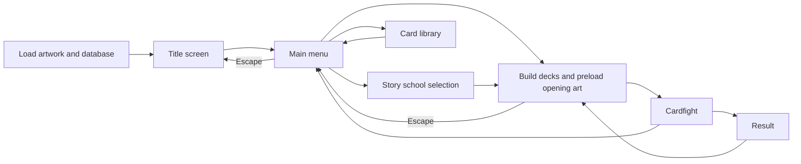

# Application architecture

## Startup and screen flow

`src/main.rs` configures the resizable Macroquad window and awaits `App::load`. The loader first creates the opening artwork and font, then renders progress between database parsing and tabletop initialization. The application subsequently draws one screen per frame.

`App` owns navigation, selected cards/attackers, temporary guard dragging, UI timers, artwork, and the active `MatchGame`. `PresentationArt` owns the landscape, transparent character renders, logo, and Rajdhani font shared by the title, menu, and loading screens. Scene particles and the title prompt animate with Macroquad time.

Starting a fight clears transient selections and enters `Screen::Loading`. The first loading stage builds the selected story chapter's decks; the second preloads visible opening-card textures. Progress reports completed stages. After the work completes, a short transition reveals the field. Escape cancels the loading screen and discards the pending match.

## Rules and battle flow

`MatchGame` contains both players, phase, turn number, chapter, message/log, outcome, and an optional `PendingAttack`. The rules layer does no drawing or I/O.

Player phases proceed through Ride, Call/Main, and Battle. Ending a turn prepares the CPU and runs its simplified ride/call/ability decisions. Each CPU attack pauses as a `PendingAttack` so the user can call guardians, intercept, or pass. Resolving an attack applies drive checks, shield, retirement or damage, sends guardians to drop, and checks for defeat. The UI waits briefly before advancing the CPU to another attack.

Rear-guard slots have a fixed meaning everywhere:

| Index | Circle |
| --- | --- |
| 0 | Left back row |
| 1 | Left front row |
| 2 | Center back row, behind Vanguard |
| 3 | Right front row |
| 4 | Right back row |

`AttackUnit` maps a Vanguard or rear-guard selection to its unit and directly aligned booster. `GuardSource` unifies hand guardians and eligible grade-two front-row interceptors. These helpers let CPU and human attacks share the same battle resolver.

This remains a simplified historical prototype: Limit Break flags and several named abilities use selected hard-coded effects; the application does not interpret all printed card text.

## Drawing, geometry, and input

`BattlefieldLayout` transforms a 720-unit-high logical tabletop into the available screen rectangle while preserving card proportions. The opposing side mirrors local positions. Rendering and click detection use the same methods for rear-guards, Vanguard, Guardian Circle, and damage cards.

The field's dark surface, metallic blue rails, yellow Rear-guard rings, blue Vanguard rings, and full green Guardian Circle follow visual cues from the official *Ride to Victory!!* screenshots. Circle graphics sample the transparent community template; auxiliary zones follow the classic field used by the prototype's card era.

Damage occupies one pocket per fighter. All damage cards are landscape/sideways rectangles, arranged in a vertical overlapping stack. Later cards draw on top. `damage_at` searches those rectangles in reverse drawing order, so an exposed strip selects its own card while an overlap selects the visible top card. Face-up and sleeve images share the same rotated bounds. Hover previews show a complete upright face for reading.

`DamageCard::face_up` stores resource state independently of sideways orientation. During the player's turn, with no unresolved battle or result, a manual click toggles this state and logs the change. Turning a card face down spends a manual resource; turning it face up is a manual Counter-Charge/correction. These controls do not activate an ability. The Limit Break button pays its own Counter-Blast 2 from remaining face-up damage.

`HandLayout` performs the equivalent shared drawing/hit-testing work for the overlapping, paginated hand ribbon. Guard dragging records the original press position and commits a guardian only on a valid release over the Guardian Circle.

## Card and artwork data

- `Card`, `Unit`, `DamageCard`, and `Player` hold factual card attributes and mutable match state.
- `game/deck.rs` reads the bundled official-era JSON and assembles sample clan lists. These are not extracted 3DS deck recipes.
- `CardArt` maps normalized names to possible printing paths, searches install/project/working-directory roots, and caches visible textures. A missing printing can fall back to another printing with the same name.
- Tabletop textures, title artwork, and the font are embedded at compile time. Card faces are loaded from the bundled `assets/card_images` tree at runtime.
- The asset fetchers refresh downloaded content and provenance. The generated Planet Cray-inspired landscape is kept separately with its exact image-generation prompt; running the download script does not regenerate it.

## Verification

The current tests cover attack targets, boosters, guards/intercepts, CPU battle pauses, selected trigger behavior, damage resource changes, overlapping damage hit order, sideways proportions, both Guardian Circle halves, hand pagination, and card-art fallback paths. Build/format checks cover compilation and formatting. Native visual review covers the title/menu scene, dark field, complete Guardian Circle, sideways stack, and Counter-Blast interaction.
