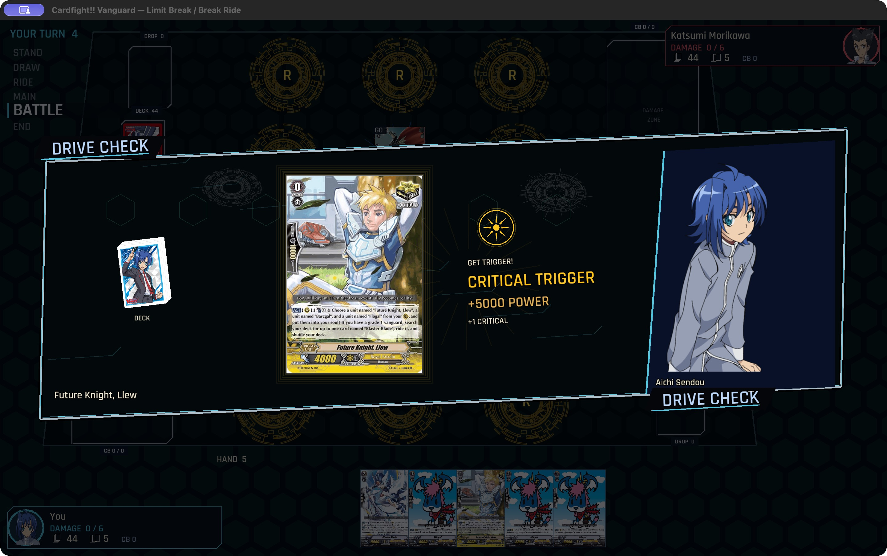
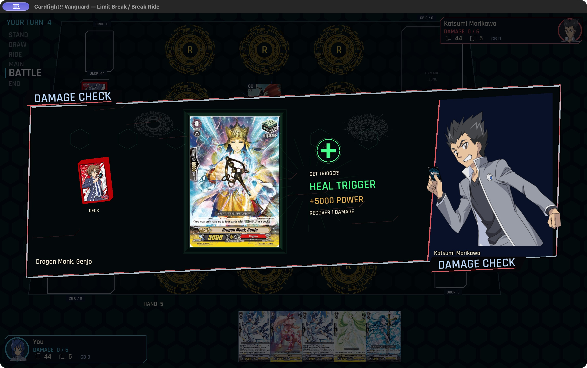

# Drive and damage check presentation

Drive and damage reveals use an English cut-in inspired by the supplied classic-game screenshot and the Dear Days publisher trailer. A slanted metallic frame enters over the field, the checking card travels from that fighter's deck, flips from its sleeve to its real face, and returns toward the Trigger Check Zone as the frame exits.

## Fighter identity

The character belongs to the **checking fighter**, rather than always to the attacker:

| Attack | Drive check | Damage check |
| --- | --- | --- |
| Your Vanguard attacks | Your fighter | Opposing fighter, if the attack hits their Vanguard |
| Opposing Vanguard attacks | Opposing fighter | Your fighter, if the attack hits your Vanguard |
| Rear-guard attacks | No drive check | Defending fighter, if the attack hits their Vanguard |

The cut-in resolves the checking side to the current match fighter's name, standing render, and side accent. The prototype's `You` identity uses Aichi, matching the existing player HUD. Other named player fighters use their own matching art. Opponents use their actual story/rival name, including names prefixed with Reversed. Available standing renders cover Aichi, Kai, Morikawa, Kamui, Misaki, Ren, Asaka, Leon, Naoki, and Takuto. Unknown names fall back to a matching portrait or initial instead of borrowing another fighter's image.

The card back matches the existing tabletop sleeve for that side: Aichi for the player and Kai for the CPU. There is no separate sleeve-selection system in this prototype.

## Motion and trigger announcements

- The frame enters in 0.24 seconds, with circuit traces, metallic borders, era zone art, and repeated **DRIVE CHECK** or **DAMAGE CHECK** ribbons.
- The card travels from the correct deck. A horizontal flip runs from 0.34 to 0.76 seconds, followed by a brief reveal flash.
- Trigger announcements begin at 0.90 seconds: **GET TRIGGER!**, the English trigger type, a colored symbol/burst, and **+5000 POWER** for the supported classic-era pool.
- Critical is gold and announces +1 critical; Draw is red and announces one extra card; Stand is blue and announces a rear-guard stand; Heal is green and announces one recovered damage when its condition is met.
- An ineligible Heal explicitly says its condition was not met. A Stand without a rear-guard says so. A trigger with no matching clan is identified as a trigger unit without promising power or another effect.
- Ordinary cards show **NO TRIGGER** and finish after 1.55 seconds. Trigger cards finish after 2.65 seconds. The final 0.30 seconds fade/slide back toward the checking side's zone.

CPU/check progression and field/action input wait for the visible cut-in to finish. Then ordinary battle progression resumes, or the required human Power/Critical/Stand/Heal selection appears on the normal field. Escape can return to Menu during the animation. The existing automatic check pace between steps and guard/resolve controls otherwise keep their current behavior.

## Events and engine boundary

`MatchGame::check_reveal` stores a numbered `CheckReveal` snapshot for every actual drive/damage draw. It includes kind, checking side, card, matching-clan eligibility, and secondary-effect availability. Sequence numbers distinguish identical consecutive cards, including Twin Drive. Rear-guard attacks do not generate drive events. Failed/empty draws produce no fake reveals.

`ui/check_animation.rs` observes each sequence once and owns its start time. Rendering never mutates card zones, applies trigger effects, or changes targets. When the engine commits the card into hand (Drive) or damage (Damage), it clears the side's `last_check` marker immediately. The field therefore stops drawing that card in the Trigger Check Zone; the numbered event snapshot is presentation history, not another copy in the zone. `App::draw_match` waits on `CheckAnimation::active` before advancing another check or CPU turn; the existing engine still owns all trigger choices and effects. Starting a new fight resets presentation state.

Card art, character renders, sleeves, and circles are existing collected assets. The English typography, frame, circuit motion, glows, and trigger symbols are drawn in code. The supplied screenshots are research material and are not embedded as UI textures. See [asset provenance](../assets/README.md) and the [reference archive](images/references/README.md).

## Verification

Run `cargo fmt --check`, `cargo test`, and `cargo build`. Tests check both checking sides, identical Twin Drive cards, sequential reveal IDs, rear-guard damage without drive events, animation duration/restart behavior, trigger eligibility wording, and fighter identity. Existing sixth-damage Heal and split-trigger tests remain in place.

A live native regression also completed a Critical Twin Drive attack: the trigger held for approximately 2.66 seconds, the normal second check for 1.57 seconds, both human power/critical choices paused correctly, and two opponent damage reveals completed before returning control.

The native captures above use temporary review-only startup states held at a reveal frame. Those startup overrides live outside the repository; the shipping app reaches the animation through ordinary fights and keeps its normal title/menu startup.
