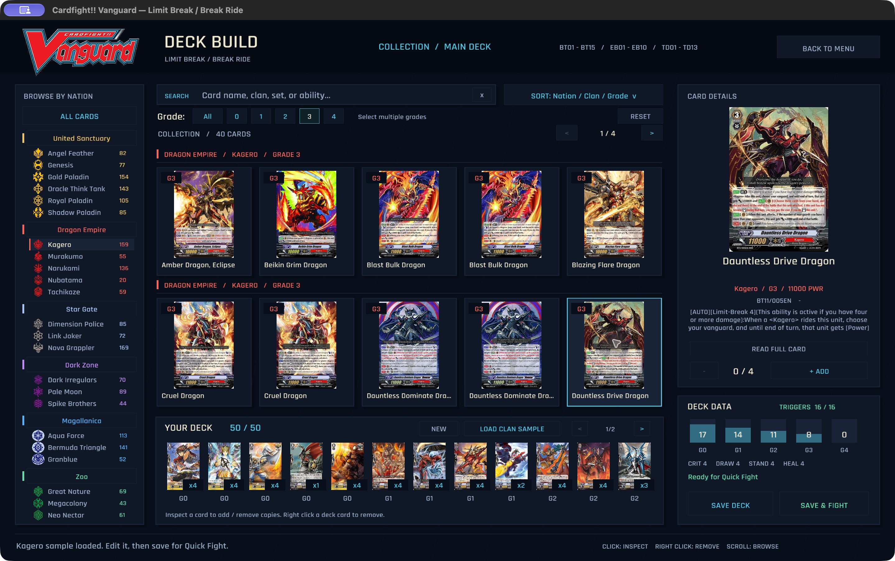

# Deck workshop

Open **Deck Builder** from the main menu. The workshop fills the available app viewport and keeps collection browsing, a large card preview, your deck, and live deck data visible together.

## Browse and sort

- **All Cards** clears nation, clan, grade, and search filters to show the complete 2,083-printing catalog.
- Six colored nation dividers contain the 23 clans. Each clan has its actual wiki unit symbol, name, and catalog count. Click a nation to browse its clans together, or a clan such as **Kagero** to show only that clan.
- **Grade: All 0 1 2 3 4** is always visible at the top. Grade buttons toggle independently; selecting 1 and 3 shows either grade within the current clan/nation/search. All clears the grade selection. Grade 4 is included because the catalog contains two Nouvelle Vague printings; the existing prototype engine still limits normal rides to grade three.
- Click the search field to search names, card numbers, clans, countries, sets, and ability text. Enter leaves text entry. Clearing or changing a filter returns to page one.
- The **Sort** dropdown stays in the top toolbar. Options are Nation / Clan / Grade (default), Name A–Z, Grade ascending, Power descending, and Card Number. Default rows show explicit colored nation / clan / grade dividers. Other sorts order the whole filtered result.
- Use the collection arrows or mouse wheel over the collection to change pages. Different printings remain available; their copy limits are shared by card name.

The source catalog places fourteen Spike Brothers printings in Zoo. The editor normalizes those entries to Dark Zone for nation browsing and grouping, preserving the original catalog file.

## Build and play

Select a collection or deck card to inspect it. **+ Add** and **−** change its quantity; right click a collection/deck card to remove that exact printing. The enlarged preview and **Read Full Card** open the full image, printed stats, and ability text. Escape closes the detail overlay before leaving the workshop.

Choose a clan, then **Load Clan Sample** for a starting list. Samples use a non-trigger Grade 0 starter, 16 triggers, 14 Grade 1, 11 Grade 2, and eight Grade 3 cards, without exceeding four copies of a named card. A clan without a trigger type uses another available named trigger. **New** clears the draft; it does not delete the saved Quick Fight deck.

The deck strip pages through its unique printings with quantity badges. Deck Data shows live grade distribution and Critical / Draw / Stand / Heal counts. Adding a card enforces deck capacity, one clan, and the shared four-copy limit. Saving additionally requires exactly 50 cards, exactly 16 triggers, at most four Heals, and a non-trigger Grade 0 starter. These are the prototype's supported classic construction checks; special mixed-clan/card-name exceptions are not implemented.

**Save Deck** stores the validated list without leaving the editor. **Save & Fight** saves and starts Quick Fight using that list and the existing RPS/mulligan sequence. Later Quick Fights use the saved deck; Story Mode retains its chapter decks. Without a saved custom deck, Quick Fight retains its generated sample.

The saved JSON contains printing numbers rather than unstable array indices. It is written via a temporary file and rename. On macOS it lives at `~/Library/Application Support/CF-Vanguard/quick-fight-deck.json`; Windows uses `%APPDATA%/CF-Vanguard`, and Linux uses `$XDG_DATA_HOME/CF-Vanguard` or `~/.local/share/CF-Vanguard`. Missing or invalid saved files do not stop startup; load/save errors appear in the workshop status line. Draft changes remain in memory while navigating the app and must be saved before quitting.

## Visual references and assets

The design combines [Cardfight!! Area's clan list, grade filters, and sorting](https://cardfight-wiki.ru/#deck-editor) with the card-focused storage/deck separation and grade/trigger data shown in Dear Days / Dear Days 2. See the [Dear Days 2 Nintendo screenshots](https://www.nintendo.com/es-pe/store/products/cardfight-vanguard-dear-days-2-switch/) and [Dear Days guide](https://gameplay.tips/guides/cardfight-vanguard-dear-days-general-guide.html). These inform presentation; modern Ride Deck and Order zones are not added to this era.

Runtime art uses the bundled official card images, official English Vanguard logo, existing Kai sleeve, and 23 original clan-symbol PNGs downloaded from the wiki, including the [user's Kagero reference](https://static.wikia.nocookie.net/cardfight/images/1/12/Icon_Kagero.png/revision/latest?cb=20160923005243). The clan manifest records every source page, direct original-image URL, dimension, and SHA-256 hash. Refresh icons with `python3 scripts/fetch_clan_icons.py` after installing `requirements-assets.txt`. No generated symbol substitutes are used.

## Implementation and verification

`src/game/deck_editor.rs` owns filtering, numeric sorting, nation normalization, editing, validation, sample recipes, and persistence. `src/ui/deck_workshop.rs` owns presentation and pointer input. Both drawing and input use the same full-viewport logical transform, including on Retina displays. Card textures use exact-printing keys in the existing bounded `CardArt` cache, so same-name versions show the selected printing's actual art; symbols/logo/sleeve are embedded.

`MatchGame::with_player_deck` accepts a validated, shuffled list and uses the normal starter/opening preparation. Card conversion preserves printed power, shield, trigger kind, and the prototype's supported Limit Break/Break Ride flags. Arbitrary printed abilities remain subject to the existing engine simplifications.

Checks: `cargo fmt --check`, `cargo test`, and `cargo build`. Editor tests cover filter intersection, multiple grades, all sort modes, corrected nation grouping, shared reprint limits, same-clan editing, valid samples for all 23 clans, saved-list round trips and rejection, exact-printing artwork resolution, and a custom deck entering the normal opening with five hand cards and 44 remaining deck cards. Native review checks collection/grade/clan controls, preview/details, samples, sorting, save, and Quick Fight transitions.
