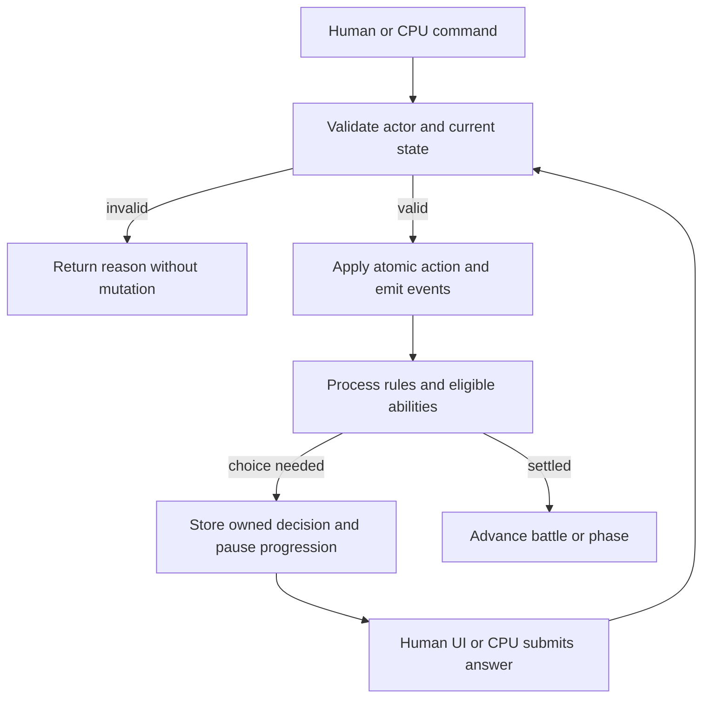

# VangPro research and reverse-engineering notes

Research date: **November 24, 2026**. Target project: **CF-Vanguard**, Rust/Macroquad, historical Break Ride/Link Joker card pool. Baseline reviewed: commit `4db125ab771e4ddd9829895a3cb0c34ec3b94640`.

Status: research document and implementation proposal; no gameplay changes are included.

## What we should take from VangPro

VangPro is a fan-made Vanguard tabletop simulator and a useful reference for card inspection, deck testing, explicit gameplay choices, and manual actions for unsupported abilities. Its release history is also a useful catalogue of failures to design against: battles completing during choices, stale selections causing unintended moves, inconsistent online boards, and image loading blocking navigation. [Store description][apple] · [Timing/loading fixes][aug21] · [Input fixes][interaction]

For this project, the strongest next steps are:

- Add a persistent card inspector and context-sensitive action panel around our existing board.
- Let players choose Counter-Blast payments, effect targets, trigger recipients, and healed damage cards.
- Add a local deck editor, saved decks, opening-hand tests, and mulligan.
- Support those features with stable instances, shared human/CPU decisions, and exact abilities for a small set of story decks.
- Build replay and online play on versioned state and commands after local decisions work correctly.

Keep the current Ride to Victory-inspired field, Aichi/Kai opening, complete Guardian Circle, and sideways overlapping damage pocket. VangPro supplies interaction and engineering lessons; its modern-format controls do not establish the rules of our historical format.

## Evidence and limits

This pass combines primary developer announcements, official store screenshots, public release-file inspection, selected .NET metadata and IL call inspection, and a review of our source code. It did **not** include playing a live VangPro match, installing the Windows client, authenticating to its services, or inspecting its servers. Static code can include disabled or unused functionality; a symbol alone does not establish that a feature works.

The following labels distinguish the evidence:

| Label | Meaning |
| --- | --- |
| **Observed** | Visible in a retrieved screenshot, public file, metadata table, or selected method body. |
| **Developer statement** | A capability or fix described by DOT; not independently exercised here. |
| **Inference** | An interpretation supported by those observations, with remaining uncertainty. |
| **Proposal** | An original design for our application, not recovered VangPro source. |

### Identity and current release

The creator publishes as **DOT**, using **VangEditor** for the developer account; Apple's seller is **JAEHO LIM**. VangPro and VangEditor are related applications, but their release-note sections must be read separately. A VangEditor database count or loading change is not automatically a VangPro fact. [Creator/distribution links][creator] · [Apple listing][apple]

Apple's live lookup returned **15.1.3**, released **2026-11-14 00:25:43 UTC**, bundle identifier `com.DOT.VangPro`, and a download size of **1,061,482,496 bytes**. The creator-linked PC folder contained **VangPro Win (15.1.3).zip**, **984,876,086 bytes**; its build manifest and Unity player settings also identify version **15.1.3**. These are the release identifiers observed during this pass, not a promise that all platforms behave identically. [Apple metadata][apple-api] · [Public PC release][release]

The store advertises deck search/filtering and codes, public/private rooms, CPU practice with difficulty selection, table cosmetics, multilingual UI, and custom-card imports. It also advertises saved replays, which conflicts with the dated removal notice below. [Apple listing][apple]

### Important version differences

| Evidence | What it establishes | Consequence for our research |
| --- | --- | --- |
| Oct. 15, 2026 announcement | The developer planned to replace unreliable automation and temporarily withdraw P Standard support. | Old videos and tutorials cannot establish current automation or format support. [Development announcement][oct15] |
| Oct. 30, 2026 notice | Card effects were manual at that point; replays were unavailable and match history had been removed. | Do not list replay playback as a verified current feature. [October update][oct30] |
| Nov. 6, 2026, v15.0.9 | Developer reported every ability supported on 3,659 of 7,503 effect-text cards: **48.8%**. | This measures fully covered cards. [Automation update][nov6] |
| Nov. 14, 2026 notice | Developer reported about **77% of card effects** handled automatically, with manual fallback. | Different denominator; this is not evidence that 77% of cards are completely automated. [November update][nov14] |
| Inspected Windows v15.1.3 method | The format-availability predicate accepts the D Standard enum value and rejects P Standard. | P Standard-related assets or classes remaining in the package do not prove the format is enabled. [Public release][release] |
| Inspected Windows v15.1.3 feature gates | Custom-card support returns false; the import window checks that gate. Card-effect automation has a separate enabled gate. | The bundled custom-card manual describes a disabled feature in this build. Do not generalize that result to uninspected mobile builds. [Public release][release] |
| Inspected Windows v15.1.3 replay UI | The replay entry is disabled, its list deactivates itself, and the replay-start handler is a no-op. | The store's replay claim is not supported by this Windows UI. Other builds/platforms remain untested. [Public release][release] |
| Store title screenshot | Its visible application version is **14.1.0**; the lobby shows server **14.0.7**. | Treat these screenshots as historical layout evidence. [Title screenshot][shot-title] · [Lobby screenshot][shot-lobby] |

No reviewed later announcement explicitly restored replay playback; the inspected Windows UI remains disabled. Availability on other platforms remains unverified. Likewise, disabled P Standard does not mean every related asset was physically removed.

## Interface and interaction reconstruction

### Title, lobby, and deck editor

**Observed screenshots:** the title provides login, guest login, guide, version, and update controls. The lobby separates CPU practice, single play, rooms, and deck editing. Room rows display format, restrictions, region flags, and occupancy. The deck editor places card information on the left, the deck grid in the center, and card browsing/details on the right, with save/load controls below. Its pictured Ride 4/4 and Main 50/50 counts belong to the displayed modern deck, not our format. [Title][shot-title] · [Lobby][shot-lobby] · [Deck editor][shot-deck]

**Proposal:** keep our character-led title, then offer Story, Quick Fight, Decks, Card Library, and Settings. Start CPU practice without an account. A future Online entry can own connectivity and account status without making local play depend on a service.

For the editor, use the current historical catalog and clan filters. Show grade, trigger, and copy counts alongside a validation summary. Keep gameplay identity separate from selected printing/artwork. Save locally first, preserve invalid imported decks as editable drafts, and explain each violation. Do not silently discard cards when restrictions change.

The developer documents in-editor restriction checks and persistence, plus five-language keyword search. It also describes removing invalid cards during deck load. That last behavior is a useful comparison point, but our proposed draft-and-diagnostics flow should preserve the user's original deck. [October update][oct30]

### Match screen

**Observed:** the pictured battle UI has a large left card-information panel, a central perspective field, hand cards along the bottom, phase controls, zone counts, and a right action rail including guard/no-guard and check controls. The screenshot contains a mulligan notification. It does not demonstrate a populated damage stack or prove the current gesture for Counter-Blast. [Battle screenshot][shot-battle]

**Proposal for our board:**

| Area | Proposed behavior | Existing integration point |
| --- | --- | --- |
| Left inspector | Full upright card image, readable effect text, base/current stats, selected printing, automation status. Pin selection during targeting. | `src/ui/cards.rs`, `src/ui/art.rs`, `src/ui.rs` |
| Center | Retain the current classic field and shared Guardian Circle; highlight legal targets and active decisions. | `src/ui/board.rs` |
| Right actions | Group phase, battle, ability, zone, and options controls. Offer actions from engine legality results. | `src/ui/match_hud.rs` |
| Bottom hand | Preserve overlap hit order; add deliberate selection and contextual Ride/Call/Guard commands. | `src/ui/cards.rs` |
| Decision banner | State whose choice is required, what is being selected, how many, and whether passing is legal. | `src/ui.rs`, future decision state |

Recent developer notes explicitly improve left-panel visibility during target selection, group right-side buttons, and give damage its own control. A separate notice addresses accidental calls after selecting the deck and an unwanted damage-zone long-press popup. These support prioritizing visible context and reliable selection boundaries. [November update][nov14] · [Interaction update; exact publication date not resolved][interaction]

### Inputs and discoverability

The older tutorial mirror describes left-click selection, right-click inspection, modifier shortcuts, and mobile tap/double-tap/long-press equivalents. These are **historical instructions**, not verified v15.1.3 bindings. The original developer post confirms that a tutorial was distributed, but the public folder now exposes the release archive rather than that standalone guide. [Developer guide announcement][guide-post] · [Historical guide mirror][guide-mirror]

**Current static input clue:** the Windows client's double-click dispatch routes the damage-zone enum case to a face-toggle operation, with a spectator read-only check. This establishes a code path, not a live test of gesture recognition, touch timing, or every match context. [Selected method-body inspection][release]

**Proposal:** every essential operation should have a visible control. Add shortcuts as accelerators and show them beside the action. During text entry, suppress gameplay shortcuts. Capture a press target and release target; cancel a drag when movement exceeds the click threshold, and discard stale selections when a card moves or a decision ends. A click used to open a menu must not pass through to the field beneath it.

### Damage and Counter-Blast

Our existing stack already matches the requested presentation: sideways full card images in one overlapping pocket, reverse-order hit testing, sleeve backs for spent damage, and upright hover previews for face-up cards. The important next improvement is connecting that presentation to explicit ability costs.

**Proposal:** when an ability requests Counter-Blast 2, display “Choose 2 face-up damage cards,” highlight eligible exposed strips, and show selected cards with an outline. Keep a visible `face-up / total damage` count. An optional expanded inspection view can make obscured cards readable while the board itself remains a stack. Permit inspection of a face-down damage card without turning it face up or restoring a resource; its face remains public information in this era. [Damage visibility, section 4.8.2.1][rules2014]

Confirming a valid cost should emit one engine command identifying the chosen card instances. The engine validates the ability, decision owner, card locations, face states, and complete cost. Canceling before commitment changes nothing. After a cost is committed, follow the printed effect even if later targets disappear; a generic undo must not refund a paid cost. For this era's default multi-part payment, validate every part before committing the combined cost. [Historical payment rule, section 8.5.2.3][rules2014]

The existing free manual flip is useful for sandbox corrections. In a strict match, automatic cost payment and a manual flip must not both spend the same resource. Future opponent-turn abilities also need a proper decision path: the current `can_flip_damage` intentionally disallows free flips during CPU turns, so it cannot be the general permission check for paying those abilities.

Sideways orientation is presentation. Face-up versus face-down is resource state. Neither should be inferred from the other. Counter-Blast leaves the card in damage and total damage unchanged. This rule distinction is supported by the official historical rules, independently of VangPro. [2014 rules, sections 4.8 and 10.1.15][rules2014]

## What the public Windows package reveals

### Inspection method

The release was located through the creator's public distribution link. HTTP byte-range requests retrieved the ZIP directory and selected members, rather than downloading or running the entire roughly 939 MiB archive. ZIP CRC checks succeeded for the extracted members. Python `dnfile` parsed managed metadata; `dncil` decoded selected method bodies to inspect calls and a small format predicate. No executable or downloaded assembly was loaded as application code.

The directory contains **16,639 entries**, including directory records, totaling **1,319,436,088 uncompressed bytes**. Inspection artifacts stayed in temporary research storage. This repository contains findings and our proposed designs, not the downloaded client, recovered method bodies, or its artwork. [Public Windows package][release]

### Technology findings

| Finding | Evidence strength | What we can conclude |
| --- | --- | --- |
| Unity with managed C# gameplay | Unity player, Mono runtime, and `Assembly-CSharp.dll` in the release. | Confirmed shipped runtime family; this is not a Rust library we can import. |
| Photon networking and chat | Packaged Photon assemblies, referenced from the gameplay assembly; selected transport/send methods reach Photon event APIs. | Strong evidence of the gameplay transport path. Does not establish server authority or anti-cheat guarantees. |
| Firebase authentication and database | Packaged/referenced components; a shared-deck transport explicitly targets Firebase. | Authentication and cloud deck storage are supported architectural roles. Do not infer that Firebase carries every game action. |
| Addressables content | Local catalog, Windows target configuration, and Addressables version **1.22.3**. | Confirmed content system in this build; not evidence that all content is remotely streamed. |
| Recovery and reliable application messages | Command IDs, acknowledgments, resend queues, snapshot/checksum routines, and selected receive/send calls. | Application-level recovery exists beyond simply opening a connection. Runtime correctness was not tested. |
| Separate ability data and choice handling | Ability catalog/resolver/choice types and their method relationships. | Strong evidence of structured ability resolution. Does not establish full rules coverage. |

All rows are static observations from the [same inspected release][release]. Component presence and call relationships describe the shipped client, not its private server implementation.

### State, commands, and decisions

The inspected metadata distinguishes card state, action execution, battle state, network commands, and recovery snapshots. Battle data includes separate attacker/defender decisions, check counts, guard state, and progress through resolution. Recovery records include card identity, state, zones, and version information. Saved decks separately track format, restrictions, schema/data revisions, card identity, and printing choice. [Public release metadata][release]

A choice interface named `ICardEffectChoices` exposes confirmation, card selection, circle selection, and option selection. **Observed:** both the popup-choice type and a CPU-choice type implement that interface. **Inference:** this provides a common boundary for human and CPU answers to ability resolution. It is a particularly useful pattern to reproduce independently in Rust; its runtime timing was not exercised here.

Selected receive logic calls sender validation, acknowledgment handling, duplicate detection, application, and deferred-command processing. Selected send logic uses a reliable-send path and a pending-ack retry mechanism. **Inference:** VangPro combines event-style replication with ordering/recovery machinery. This does not prove a deterministic event-sourced engine, a fully authoritative server, or complete protection of hidden information.

The observed ability catalog loads structured data, and resolver metadata separates conditions, costs, triggers, steps, and usage limits. An older 2024 post describes phrase-dependent automation, but that should not be presented as the architecture of the rebuilt 2026 engine. [Public release][release] · [Historical phrase-matching note][sep2024]

### Bundled ability-data inspection

The serialized resource header identifies Unity version **2022.3.62f2**. Parsing that file as data also identified an embedded structured ability catalog with schema version **2**. Aggregate counts from that asset are:

| Entry kind | Records |
| --- | ---: |
| Automatic | 4,602 |
| Continuous | 1,346 |
| Activated | 680 |
| Order | 268 |
| Skill | 74 |
| **Total** | **6,970** |

Those records reference **6,238 distinct associated card IDs**. All records have an active status, but **123 also carry an explicit manual marker**, whose runtime meaning was not independently established. Counting active records is insufficient to measure complete automation. Top-level step data contains 116 distinct operation names; conditional branches and nested steps mean that is not a count of fully implemented features. [Embedded data in public release][release]

**Inference:** a structured execution vocabulary, card-to-ability mappings, conditional steps, and separate choice handling are a substantially better model for our next iteration than adding more booleans to `Card`. These counts establish stored data, not successful execution, full card coverage, or a reproduction of the developer's 77% calculation. No printed card-text corpus or ability definitions were copied into this repository.

One important qualification: a separate continuous-effects feature gate is disabled, while the newer card-effect automation gate is enabled. These are distinct paths; the first flag does not prove all CONT abilities are disabled in the newer engine. This is another reason to inspect both data and the paths that use it. [Inspected public release][release]

### Custom cards

**Current-build qualification:** selected method bodies show custom-card support disabled, and the import wizard/window consult that flag. The following describes the **bundled format and intended workflow**, not a verified usable feature in Windows v15.1.3. [Inspected public release][release]

The bundled English custom-card manual documents a spreadsheet/CSV plus image-ZIP import, validation before saving, stable custom identity, and separate definition/image hashes. It says peers need matching packages before a match and that custom effect text is for display; execution needs separate implementation. This is documentation evidence, not a live multiplayer import test. [Bundled manual in public release][release]

**Proposal:** if custom cards are added later, start with a versioned JSON format that our existing tooling can validate. Keep data and artwork hashes separate, reject ambiguous duplicate IDs, cap archive/file sizes, and preserve provenance. A definition describes a card; it must not execute arbitrary code. Imported text should display a clear “manual effect” status until a trusted ability definition exists.

The package also contains sharing-related code. Its presence is insufficient to override the disabled feature gate, the manual's stated same-package requirement, or establish a reachable sharing flow.

## Local source review: what we already have and what is missing

These findings come from our checked-out source, not VangPro.

| Area | Current implementation | Implication |
| --- | --- | --- |
| Card identity | `Card` carries name/clan and simplified attributes; zones store cloned cards and UI selections use indices. | Add stable definition, printing, and match-instance identities before persistence or networked targeting. |
| Deck construction | `build_deck` parses the bundled catalog and assembles sample clan lists. | Add a reusable catalog and editable saved deck definitions. Avoid reparsing and leaking names on repeated builds. |
| Setup | `prepare_player` selects a starter and draws an opening hand. | Add explicit first-player selection and mulligan decisions. |
| First player draw | `MatchGame::new` starts in Ride after the five-card hand; later turn starts draw a card. | Include the opening turn's draw in the historical setup/turn audit. |
| Legality | UI option lists filter rides/calls, while `ride` itself mainly checks phase and index. | Put complete legality validation at the command boundary; UI filtering alone is insufficient. |
| Calling | Trigger units are filtered out, occupied circles are rejected, and CPU setup uses a fixed pair of calls. | Audit against the selected historical rules; expose legal trigger calls, overcalls, and movement deliberately. |
| First attack | `can_attack` checks phase, pending attack, and unit availability without a first-turn prohibition. | Add an explicit first-player/first-turn rule before treating matches as rules accurate. |
| Battle choices | `PendingAttack` already pauses CPU attacks for guardians and intercepts. | Extend this successful pause mechanism into general choices. |
| Triggers/heals | `apply_trigger` chooses power/stand recipients automatically and healing removes a fixed damage card. | Add player choices and preserve check order. |
| Ability support | Broad Limit Break/Break Ride flags plus named hard-coded branches. | Separate exact ability support from catalog availability. |
| Resource payment | Manual damage flip shares state with automatic Counter-Blast; the LB button chooses its own payment cards. | Add selected cost payment without double charging. |
| Log/replay | Match log retains eight strings, not a durable command/event history. | Introduce structured history before replay UI. |
| Rule loss | `deck_out` is set after a failed draw; outcome checks use that flag. | Audit empty-deck check timing, rather than assuming a failed draw is the historical loss condition. |
| Art loading | Name-normalized lookup, runtime decode, cache limit 150 textures. | Add printing-aware keys and staged loading if editor browsing expands. |
| Online play | No transport, serialization, lobby, or reconnect layer. | Multiplayer is a separate project after the local engine boundary is stable. |

Relevant source: [card model](../../src/game/card.rs), [deck setup](../../src/game/deck.rs), [engine](../../src/game/engine.rs), [UI state](../../src/ui.rs), [art loading](../../src/ui/art.rs). These repository-relative links are intended for GitHub rendering.

Historical rule verification confirms that normal calls are grade constrained rather than categorically excluding trigger units, first-turn attacks are prohibited, and triggers/healing involve player choices. Use the **2014 rulebook** for this era; modern ride-deck and energy rules must not enter by accident. [Rules sections 2.8, 7.2.1.3, and 8.5.2.1.1.2][rules2014]

Era deck validation should explicitly cover 50 cards including the starter, 16 triggers, four-copy limits by name, and the period's Heal/Sentinel limits. The historical mulligan shuffles selected cards back before drawing replacements. Pin these policies to a rules profile rather than importing a modern simulator's defaults. [2014 setup rules, section 5][rules2014]

## Proposed Rust design

Everything in this section is an original proposal for CF-Vanguard. Names and structures are illustrative, not extracted VangPro code or an implementation delivered by this research task.

### Identity and saved data

Separate four concepts:

| Concept | Purpose |
| --- | --- |
| Definition identity | Rules identity of a card; independent of localized name or artwork. |
| Printing identity | Particular card number/artwork/language. Reprints may share rules identity. |
| Instance identity | One physical copy in this match; survives movement between zones. |
| Deck entry | Definition, printing preference, and copy count. |

Use a validated catalog mapping official card numbers to logical identities. Do not deduplicate by stripped names alone: punctuation, translations, and different-era cards can collide. Track a separate copy-limit grouping when rules treat cards with different printings as the same name.

An instance ID tracks the physical copy for storage and UI. Add a state/zone generation to references used by effects: a card leaving and returning must not remain a stale target merely because it is the same physical copy. Reset temporary state according to the rules for that transition.

Save decks with a schema version, rules profile, catalog revision, entries, and title. Use atomic replacement and keep the last valid file on a failed save. A catalog update should produce diagnostics for unavailable cards and preserve the original draft. Start with local files; cloud revision/conflict handling is a later addition.

For sharing, first support a portable deck file or pasted code representing our own versioned format. The VangPro package includes a Deck Log import adapter with card-resolution diagnostics. A future external-code adapter for our app should map official identifiers into the local catalog, report unresolved or out-of-era entries, and leave the original import intact. Name matching can suggest candidates but must not silently substitute a different card. [Static import metadata][release]

### Commands and decisions

Move all mutations through an engine entry point such as:

```rust
// Design sketch only.
fn apply_command(
    state: &mut MatchState,
    actor: PlayerId,
    command: Command,
) -> Result<Vec<GameEvent>, RuleError>;
```

The command should describe intent—ride this instance, guard with these instances, choose these cost cards—not screen coordinates or current vector indices. Revalidate against current state every time. A rejected command returns a useful reason and leaves state unchanged.

Track the active fighter separately from the phase; CPU control should be a policy, not a distinct rules phase. Give every turn and match a generation so delayed choices can be rejected. Represent a draw explicitly in the outcome model instead of limiting results to a boolean human-win flag.

A pending decision needs an ID, owner, source ability, prompt kind, eligible instance IDs, selection bounds, optionality, and continuation. If a cost is reserved while the user makes other required choices, those reservations belong to that resolution. Commit only after complete validation. Once a cost has been paid, later effect resolution follows the rules rather than a blanket rollback.

An answer should be a separate command scoped to the pending decision ID, not a repeated activation of the ability. Consuming the decision once prevents a double click or retried message from charging the cost or applying the effect again.



This diagram describes a control boundary, not a replacement for Vanguard's detailed check timings. Rule actions, simultaneous abilities, continuous effects, and turn-player ordering must be implemented from the era rules. Animations may follow committed events, but an animation timeout must never answer a rules decision.

### Abilities and manual play

Start with a small explicit catalog for the actual story decks: conditions, legal timing, costs, choices, operations, and duration. Keep printed/localized text separate from executable definitions. An ability requires its own support status and verified scenarios; a single `limit_break` boolean cannot represent every card with Limit Break.

Expose **Fully automated**, **Partially automated**, or **Manual** at card inspection and before a match. In strict mode, allow only the supported rules/card set. In sandbox mode, expose deliberate zone/resource adjustments and record them distinctly. A manual adjustment must not silently retrigger an already automated ability.

For coverage reporting, publish both **fully supported cards / tested card set** and **supported abilities / expected abilities**. Keep these denominators explicit. Claiming one percentage without its unit would repeat the ambiguity found in the external announcements.

### A concrete first ability milestone

Use a few existing era cards to exercise the architecture before expanding the pool. These are **our proposed implementation fixtures**, checked against Bushiroad's card entries, not claims about VangPro's implementation of these cards.

| Card | What an exact implementation must distinguish | What it proves |
| --- | --- | --- |
| **Blaster Blade, BT01/002EN** | Vanguard-entry and rear-guard-entry abilities have different target conditions. Each offers an optional Counter-Blast 2 payment, then retires an eligible chosen rear-guard. | Entry events, optional cost, chosen damage cards, target filtering, once per triggering event. [Official entry and FAQ][blaster] |
| **Dauntless Drive Dragon, BT11/005EN** | Its Break Ride grants a temporary ability to the new Kagero Vanguard. That ability offers a three-card discard at the end of its battle under a stand-history condition. | Granted abilities, duration, chosen discards, end-of-battle timing, and turn history. [Official entry][dauntless] |
| **Glory Maelstrom, BT09/002EN** | Its original Limit Break 5 attack ability costs Counter-Blast 1 and changes power and hand-guard eligibility. Intercept remains possible. | Ability-specific thresholds, exact cost, battle-scoped restrictions, and separate hand/intercept legality. [Official original printing and FAQ][glory] |

The last example exposes a concrete prototype mismatch: our resolver currently gives Glory Maelstrom critical 2 at five damage. The original card's printed ability does not grant that automatic critical increase. An exact card fixture should replace that shortcut, rather than extending a generic Limit Break button to every boss.

### CPU

The CPU should consume the same legal actions and pending decisions as the human UI. Separate policy from mutation: choosing what to do is AI; validating and performing it is the rules engine.

Begin with reproducible heuristic policies for riding, guarding, conserving key cards, choosing trigger recipients, and paying costs. Difficulty can vary evaluation quality and planning depth, while all levels obey the same timing. Never let the CPU read hidden opponent identities unless a deliberate training mode says so. Record a seed or explicit random outcomes for reproducible bug reports.

VangPro's developer has described improvements to CPU attack, guard, call, cost, and trigger decisions and a deck-editor test-hand feature. Those are useful feature targets, but this research did not benchmark its AI strength. [May practice/CPU update][may23]

### Practice aids and guard clarity

A historical sponsor-feature notice describes public trigger history, probability assistance, guard/power calculation, end-turn reminders, and a restart control. Its “replay” control in that description means restarting a fight, not playing back a recorded match. Availability and supporter terms from that 2025 notice were not verified for the current build. [Historical convenience-feature description][practice]

**Proposal:** add a training overlay after basic rules are correct. Show attack power, defender power, committed shield, and whether the current numbers hit. For example, 17,000 against 11,000 plus 5,000 shield still hits; 10,000 shield stops that current attack before further drive effects. Make that assumption visible, and update after each resolved trigger.

Use only legitimately known information for an optional trigger-odds display, and explain its assumptions. A training helper must not read the opponent's hidden hand or future shuffled order. End-turn reminders should reference actual pending abilities, and allow a deliberate pass when rules permit it. Label the rematch button **Rematch** so it cannot be confused with recorded replay playback.

### Art, loading, and presentation

Build a catalog once and prepare a match's needed images first. Queue decoding away from interaction where practical, then create/upload Macroquad textures on the appropriate render thread. Use a placeholder while art is pending. Cap work per frame and cache by printing identity; retain readable metadata even if a face image fails.

Track completed loading work separately from optional background art. Allow canceling a pending match and invalidate its queued completion callbacks. Keep sleeve and icon selections stable throughout loading.

VangPro's June posts discuss prepared card data, aliases/reprint cleanup, prioritized art, and background image work; its August notes specifically fix high-rarity downloads blocking lobby entry. These support staged readiness, without requiring us to adopt Unity Addressables. [June data update][jun8] · [June image update][jun9] · [August loading fixes][aug21]

### Replay and future networking

First build local diagnostic replays: initial state, engine/rules/catalog versions, deck definitions, and ordered accepted commands plus random outcomes. A seed alone is insufficient if algorithms or draw ordering can change. Include periodic snapshots and compare reconstructed state hashes in tests. Cosmetic timing should not affect outcomes.

A complete local debug replay contains hidden information. A player-facing replay or export needs explicit visibility rules and should not expose unrevealed hands/deck order during a live match.

Only then add private rooms: negotiated versions and rules, seat/ready state, deck validation, command sequencing, unique action IDs, deduplication, bounded retry queues, and recovery snapshots. Treat “message delivered” and “command accepted by the engine” as separate outcomes. Bind messages to a match generation so delayed traffic from a previous game cannot mutate a rematch.

Prefer an authoritative match service for competitive play. If a simpler trusted-friends model is chosen first, document that trust model. A client-supplied snapshot hash detects disagreement; it does not prove honesty. Send only the information each viewer may know. Spectators must be read-only at the engine/service boundary, not merely through disabled buttons.

The October update reports ordered resends and a spectator-control fix; November notes describe resync and rematch failures. These are failure cases to test, not evidence that copying a transport library would solve synchronization. [October network fixes][oct30] · [November recovery][nov6] · [Rematch update][nov14]

## Recommended implementation sequence

Effort sizes are relative: **S** is localized, **M** spans a few modules, and **L** needs a substantial engine or service boundary. They are planning categories, not time estimates.

| Order | Deliverable | Size | Completion criterion |
| --- | --- | --- | --- |
| 1 | Historical rule audit and centralized legality | M | Direct invalid commands cannot bypass ride/call/first-turn rules; chosen rules profile is explicit. |
| 2 | Persistent inspector and grouped contextual controls | M | Card text remains visible during selection; illegal actions explain why; existing damage stack remains intact. |
| 3 | Stable instances, commands, and pending decisions | L | Human/CPU use the same validation path; stale selections are rejected; progression stops for unresolved decisions. |
| 4 | Mulligan, chosen triggers/heals, chosen Counter-Blast | M after 3 | Decisions preserve rule order and spend exactly the selected resources once. |
| 5 | Local deck editor, save/load, test hand | L | Valid historical decks are editable and persistent; invalid imports remain recoverable drafts. |
| 6 | Exact abilities for selected starter/story decks | L, incremental | Each supported ability has timing/cost/target fixtures and visible coverage status. |
| 7 | Structured diagnostics and local replay | M/L after 3 | Recorded scenarios reconstruct the same state under the same version. |
| 8 | Private online rooms and reconnect | L | Two clients recover from duplicate/lost/delayed messages without leaking hidden information. |
| 9 | Custom cards and cosmetic selection | M/L | Validated data/assets load predictably; unsupported abilities remain explicitly manual. |

The inspector and deck work can be split into smaller visible releases, but full deck legality and exact card behavior must be distinguished. Being able to load a deck does not mean every effect is implemented.

## Acceptance scenarios worth turning into tests

These are proposed tests for later implementation; they were not added or run as part of this documentation task.

1. **First turn:** the first fighter cannot declare an attack; a sandbox override is explicit and logged.
2. **Command validation:** an invalid grade ride submitted directly to the engine leaves hand, soul, Vanguard, and phase unchanged.
3. **Counter-Blast:** select two eligible damage instances from a sideways stack; confirm once; a duplicate confirmation cannot pay twice. Cancel before commitment changes nothing.
4. **Mixed cost:** an unavailable discard or Soul-Blast prevents all payment; a completed multi-part cost is committed and recorded once.
5. **Guardian timing:** a guardian ability requiring a choice stops damage resolution and CPU progression until that choice completes.
6. **Trigger order:** finish each trigger's choices before the next check; power and critical recipients may differ when the era rules allow it.
7. **Heal choice:** choose the legal damage card to heal, including a face-down card; check defeat at the correct timing around sixth damage and a heal.
8. **Stable selection:** removing an earlier hand/damage item cannot redirect a pending selection to a different instance.
9. **Manual fallback:** a manually resolved unsupported effect is distinguishable in history and cannot also execute automatically.
10. **Deck migration:** changing restrictions reports invalid entries without overwriting the only saved copy of the deck.
11. **Loading cancel:** leaving loading and starting a new match cannot apply the old match's asset/setup completion.
12. **Replay:** the same versioned fixture produces the same state; mismatched catalog/rules versions fail clearly rather than silently replaying differently.
13. **Network retry:** a repeated action ID applies once; reordered commands wait or fail with a recovery path; bounded queues fail visibly.
14. **Reconnect:** face states, card identities, zone order, decision owner, current battle, and turn agree after recovery.
15. **Rematch:** no old timer, queued command, ability continuation, or selection survives into the next match.
16. **Visibility/roles:** an opponent/spectator view excludes hidden identities and rejects unauthorized mutations even if a client bypasses the UI.

## What remains unverified

- Live v15.1.3 gesture recognition and full input bindings, populated damage layout, and actual CPU strength. A damage-zone double-click code path was identified statically.
- Replay playback on other platforms/releases; the inspected Windows replay entry is explicitly disabled despite the store description.
- Runtime behavior of custom sharing on other releases/platforms; it is gated off in this inspected Windows build.
- Private server validation, matchmaking capacity, hidden-information handling, and service costs.
- Runtime completeness of ability automation. The published coverage percentages are developer claims, not results of this pass.
- A verified public source repository and reusable source-code license. Search results for similarly named Vanguard simulators must not be attributed to VangPro.

A later live comparison should record platform/version and test one small scripted match: mulligan, selected Counter-Blast, a guardian choice, split trigger recipients, a heal, and a rematch. Until that is observed, this document keeps those runtime details open.

## Reproducibility record

| Item | Recorded value |
| --- | --- |
| Research start | 2026-11-24 18:39:06 UTC / 1:39:06 p.m. EST |
| Requested research duration | 30 minutes |
| Research completion | 2026-11-24 19:09:10 UTC / 2:09:10 p.m. EST |
| Elapsed research window | **30 minutes, 4 seconds**, including source inspection, analysis, and report review |
| Windows archive observed | `VangPro Win (15.1.3).zip` |
| Public Drive file ID | `15IlVkCgbp0dr30zy4vTA9K0lm5m6m39d` |
| Inspected archive link | [Windows v15.1.3 ZIP](https://drive.google.com/file/d/15IlVkCgbp0dr30zy4vTA9K0lm5m6m39d/view) |
| Archive size | 984,876,086 bytes; full-archive SHA-256 not computed because only selected byte ranges were fetched |
| Gameplay assembly SHA-256 | `20a5a4771340b7d71a3882f8302026a66b95b7e45106efbd7f97e82e02b44d6a` |
| Bundled English custom-card manual SHA-256 | `b8ab906c13a8bc66bcd61036f54966ca365f61d562b09ecf119d3b4cd24d0dcd` |
| Embedded ability catalog SHA-256 | `43f7c834cc6c436947d7c1e8717946d62c4aa5d0a0f4138e315d863be6be90e4` |
| Resource asset SHA-256 | `f37893ff9f78f9abfd7d7573d67e354df7ee4523e601f7b4f5b1fa82a88deb5e` |
| Build manifest SHA-256 | `889ce33ad778e1ccea744ca5de06f38e93edf304aef7dbe7fa36ed09aa2399b6` |

To repeat the static observations, follow the [creator's distribution link][creator], identify the release in the [public folder][release], list ZIP entries, verify selected-member CRCs, and inspect managed type/method metadata. The downloaded assembly, resource file, and manual hashes also match their entries in the release's build manifest. Parse the Unity resource file with a serialized-asset reader to locate the ability text asset, then aggregate its entry kinds and flags. `UnityPy` was used for this data-only step. The exact hashes above distinguish this inspected build from a later archive with the same displayed filename. The source links below are live and may change; dates describe the evidence reviewed here.

## Source register

Primary sources are preferred. The historical tutorial mirror is the only secondary instructional source used; its age and hosting limitation are called out above.

| Source | Use in this report |
| --- | --- |
| [DOT / VangEditor creator page][creator] | Product identity and distribution chain. |
| [Apple listing][apple] and [live lookup][apple-api] | Advertised feature scope and exact observed release metadata. |
| [Creator-linked PC folder][release] | Public Windows package, bundled manual, static observations. |
| [Oct. 15, 2026 development notice][oct15] | Automation rebuild and format scope. |
| [Oct. 30, 2026 update][oct30] | Manual controls, restrictions, replay status, network behavior. |
| [Nov. 6, 2026 update][nov6] | Automation denominator, choices, recovery, loading. |
| [Nov. 14, 2026 update][nov14] | Newer coverage claim and interface/rematch fixes. |
| [Additional interaction update][interaction] | Damage gesture conflict, action grouping, accidental call prevention; exact publication date unresolved. |
| [Aug. 21, 2026 update][aug21] | Decision timing, CPU pauses, image loading and replay failure cases. |
| [June 8][jun8] and [June 9, 2026 updates][jun9] | Card data preparation, identity/art cleanup and loading priorities. |
| [May 23, 2026 update][may23] | Practice tools and CPU decision categories. |
| [Apr. 7, 2025 convenience-feature notice][practice] | Historical training aids and the rematch/replay naming distinction. |
| [Sept. 3, 2024 v7.8.0 update][sep2024] | Historical phrase-dependent automation; not attributed to current architecture. |
| [Apr. 15, 2024 guide announcement][guide-post] and [guide mirror][guide-mirror] | Historical input conventions. |
| [2014 official comprehensive rules][rules2014] | Independent era-specific rule checks. |
| [Blaster Blade][blaster], [Dauntless Drive Dragon][dauntless], and [original Glory Maelstrom][glory] | Proposed local ability fixtures; exact printed identities matter. |

[creator]: https://www.patreon.com/cw/VangEditor
[apple]: https://apps.apple.com/iq/app/vangpro/id6772739776
[apple-api]: https://itunes.apple.com/lookup?id=6772739776&country=us
[release]: https://drive.google.com/drive/folders/1631tm-JDMFwS6KV1KBbR4F5gLZ2NWxuM
[oct15]: https://www.patreon.com/VangEditor/posts/digieditor-and-172410918
[oct30]: https://www.patreon.com/VangEditor/posts/vangpro-update-173835936
[nov6]: https://www.patreon.com/VangEditor/posts/vangeditor-174555633
[nov14]: https://www.patreon.com/VangEditor/posts/vangpro-update-175279755
[interaction]: https://www.patreon.com/VangEditor/posts/vangpro-update-174706042
[aug21]: https://www.patreon.com/VangEditor/posts/vangpro-update-167257418
[jun8]: https://www.patreon.com/VangEditor/posts/vangeditor-160467278
[jun9]: https://www.patreon.com/VangEditor/posts/vangeditor-160592783
[may23]: https://www.patreon.com/VangEditor/posts/vangpro-update-159020066
[practice]: https://www.patreon.com/VangEditor/posts/vangpro-sponsor-126089113
[sep2024]: https://www.patreon.com/VangEditor/posts/vangpro-update-7-111352740
[guide-post]: https://www.patreon.com/VangEditor/posts/vangeditor-guide-102406678
[guide-mirror]: https://www.scribd.com/document/781435959/VangPro-Tutorial-Guide
[rules2014]: https://en.cf-vanguard.com/wordpress/wp-content/uploads/Cardfight-Vanguard-Comprehensive-Rules.pdf
[blaster]: https://en.cf-vanguard.com/cardlist/?cardno=BT01%2F002EN&expansion=5&view=image
[dauntless]: https://en.cf-vanguard.com/cardlist/?cardno=BT11%2F005EN&expansion=28&view=image
[glory]: https://en.cf-vanguard.com/cardlist/?cardno=BT09%2FS02EN
[shot-title]: https://is1-ssl.mzstatic.com/image/thumb/PurpleSource221/v4/79/0b/37/790b3754-14c0-d7ea-b30a-c069b8e9555c/01_APP_IPAD_PRO_3GEN_129.png/1400x1050bb.jpg
[shot-lobby]: https://is1-ssl.mzstatic.com/image/thumb/PurpleSource211/v4/c4/36/2e/c4362ee2-90e0-697d-a6cf-77d40d8042bd/02_APP_IPAD_PRO_3GEN_129.png/1400x1050bb.jpg
[shot-deck]: https://is1-ssl.mzstatic.com/image/thumb/PurpleSource221/v4/07/a8/db/07a8db44-6b5c-5a2a-0627-7eb3d2964614/03_APP_IPAD_PRO_3GEN_129.png/1400x1050bb.jpg
[shot-battle]: https://is1-ssl.mzstatic.com/image/thumb/PurpleSource221/v4/73/e7/63/73e76397-1351-c367-eca4-500b400b98cb/04_APP_IPAD_PRO_3GEN_129.png/1400x1050bb.jpg
