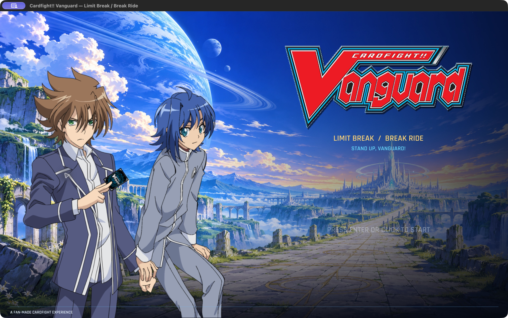

# Cardfight Simulator



A fan-made Rust desktop Cardfight!! Vanguard prototype set in the Limit Break and Break Ride era, inspired by the presentation of *Ride to Victory!!* and *Lock on Victory!!*.

The game includes Story Mode, CPU Quick Fights, and a searchable library of 2,083 era card entries with official card artwork. The field has a complete Guardian Circle and sideways overlapping damage cards that can be flipped for manual Counter-Blast.

## Run

Install Rust, then run:

```sh
cd CF-Vanguard
cargo run
```

Press **Enter** or click the title screen to open the menu. Matches load their decks and opening card artwork before revealing the field.

## Documentation

- [Game setup, controls, and prototype limits](CF-Vanguard/README.md)
- [Documentation index](CF-Vanguard/docs/README.md)
- [Architecture and screen/battle flow](CF-Vanguard/docs/architecture.md)
- [Every function and its responsibility](CF-Vanguard/docs/functions.md)
- [Historical and visual research](CF-Vanguard/RESEARCH.md)
- [Artwork sources and licenses](CF-Vanguard/assets/README.md)

## Check

```sh
cd CF-Vanguard
cargo fmt --check
cargo test
cargo build
```

This is a playable prototype with simplified CPU decisions and card effects. Character, logo, sleeve, and card artwork belongs to its respective owners; attribution and generated-art provenance are documented in the project.
